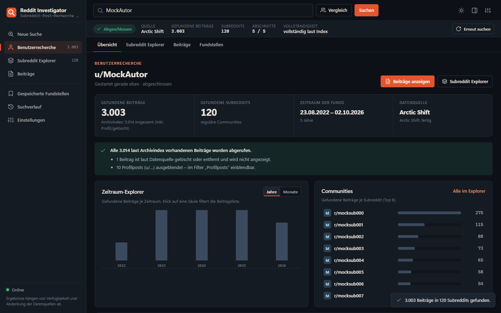
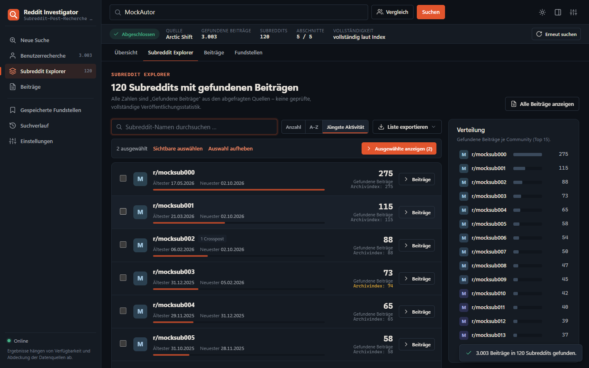
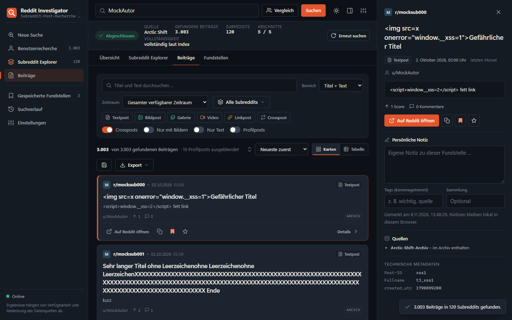
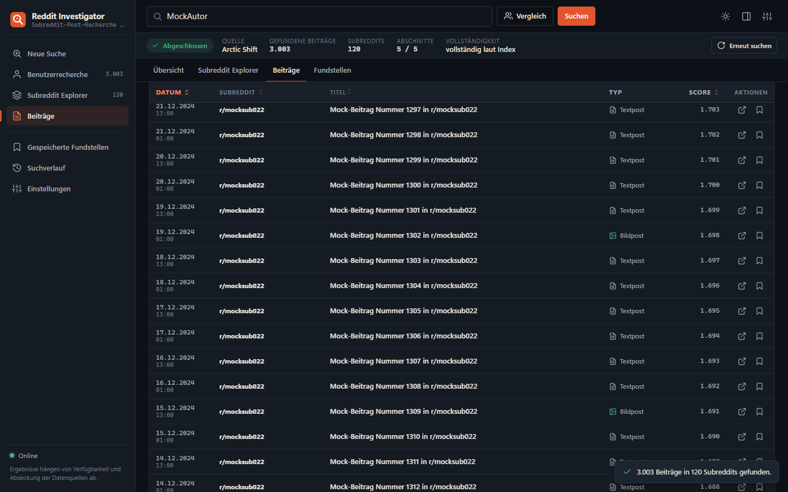
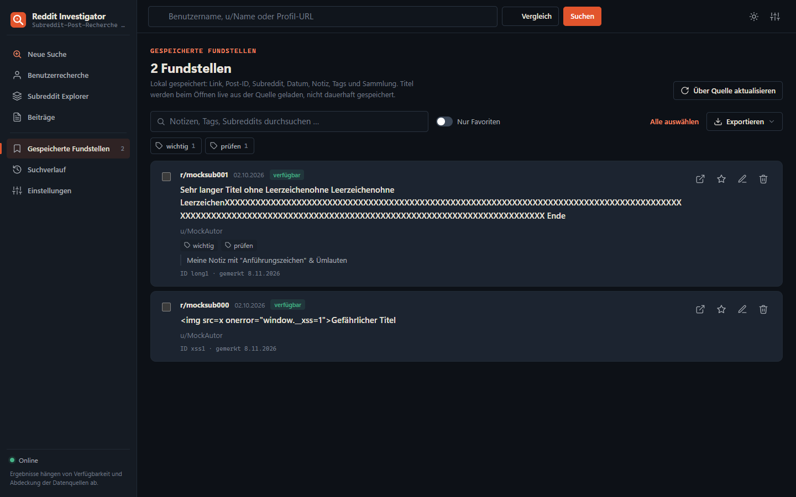
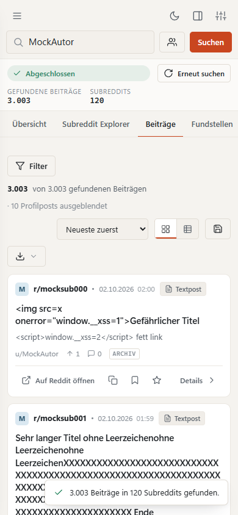
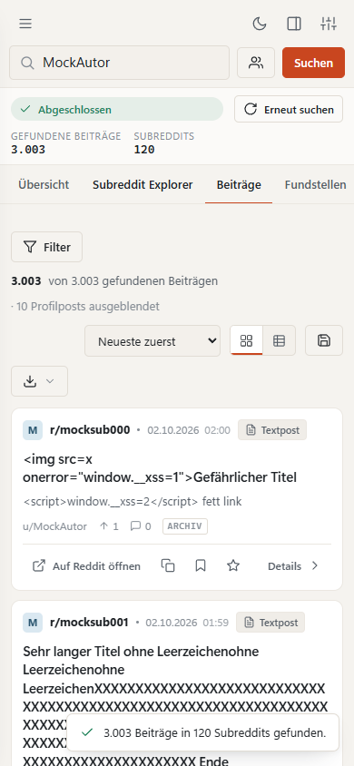

# Reddit Investigator

Lesezeichen-Hub-Modul zur **autorbezogenen Subreddit-Post-Suche**: Die Anwendung findet die eigenständigen Beiträge eines Reddit-Benutzers in allen Subreddits – nicht nur die Einträge, die seine Profilseite gerade anzeigt.

Sie fragt dafür das öffentliche [Arctic-Shift-Archiv](https://github.com/ArthurHeitmann/arctic_shift/blob/master/api/README.md) direkt nach Beiträgen des Autors ab, trennt Subreddit-Beiträge von Profilposts, zählt Kommentare nicht als Beiträge und gruppiert die Funde nach Communities.



> Alle Screenshots stammen aus den automatisierten UI-Tests und zeigen **klar gekennzeichnete Mock-Daten** (`u/MockAutor`, `r/mocksub…`), keine echten Reddit-Inhalte.

---

## Inhalt

1. [Funktionen](#funktionen)
2. [Technik](#technik)
3. [Datenquellen](#datenquellen)
4. [Installation im Lesezeichen-Hub](#installation-im-lesezeichen-hub)
5. [Bedienung](#bedienung)
6. [Suchlogik](#suchlogik)
7. [API-Grenzen](#api-grenzen)
8. [Optionaler Reddit-Adapter (Go)](#optionaler-reddit-adapter-go)
9. [Datenschutz und Sicherheit](#datenschutz-und-sicherheit)
10. [Bekannte Einschränkungen](#bekannte-einschränkungen)
11. [Lokale Entwicklung und Tests](#lokale-entwicklung-und-tests)

---

## Funktionen

**Suche**
- Eingabe als `Name`, `u/Name` oder `https://www.reddit.com/user/Name/` – wird bereinigt und validiert.
- Subredditübergreifende Autorensuche im Archiv, inklusive älterer Beiträge.
- Profilposts (`u_Name`) standardmäßig ausgeblendet, per Schalter einblendbar.
- Kommentare werden nie als Beiträge gewertet.
- Crossposts werden erkannt („Crosspost von r/… (eigenes Original)“) und bleiben vom Original getrennt.
- Laufender Suchstatus: aktive Quelle, gefundene Beiträge und Subreddits, aktuell bearbeiteter Zeitraum, abgeschlossene Abschnitte, aktive/wartende Anfragen, Rate-Limit-Pausen.
- Fortschritt nur dann als Prozentbalken, wenn der Archivindex eine echte Gesamtzahl liefert – sonst unbestimmter Indikator.
- Abbrechen, erneut versuchen, Ergebnisse erscheinen bereits während der Suche.
- Vollständigkeitsprüfung gegen den Archivindex; Lücken, Limits und Fehler werden ausdrücklich gekennzeichnet.
- Optional: zwei Benutzer neutral vergleichen, Filter „Nur gemeinsame Subreddits“.

**Subreddit Explorer**



- Alle gefundenen Communities mit Anzahl, ältestem und neuestem Fund, Monogramm, Crosspost-Anzahl und – falls verfügbar – der Anzahl laut Archivindex.
- Sortierung nach Anzahl, Name oder jüngster Aktivität; Namenssuche; Einzel- und Mehrfachauswahl.
- Balkendiagramm „Gefundene Beiträge je Community“.
- Export der angezeigten Liste als JSON, CSV oder Markdown.

**Beiträge**



- Kartenansicht mit Subreddit, Titel, Datum/Uhrzeit, Autor, Textvorschau (aufklappbar), Vorschaubild (Lazy Loading, NSFW unscharf), Beitragstyp, Score/Kommentare (nur wenn verlässlich), Quellenkennzeichnung.
- Kompakte, sortierbare **virtualisierte Tabelle** für tausende Einträge.



- Aktionen: Auf Reddit öffnen, Link kopieren, als Fundstelle merken, Favorit, Details.
- Rechte Detailspalte (ein-/ausblendbar) mit Volltext, Quellen, technischen Metadaten und persönlicher Notiz.
- Zeitraum-Explorer (Jahre/Monate) – Klick filtert die Liste.

**Filter und Sortierung** (lokal kombinierbar, ohne neue API-Abfragen)
- Zeit: gesamt, 7/30/90 Tage, letztes Jahr, Datum von/bis, Kalenderjahr, Zeitleisten-Zeitraum.
- Suchbegriff in Titel und/oder Text (mehrere Wörter, `"Phrase"`, `-Ausschluss`, umlauttolerant).
- Subreddits, Beitragstyp (Text, Bild, Galerie, Video, Link, Crosspost), Crossposts ein/aus, nur mit Bildern, nur Text, Profilposts.
- Sortierung: neueste, älteste, Titel, Subreddit, Score.
- Aktive Filter als Chips; einzeln oder gesammelt zurücksetzbar.

**Fundstellen, Verlauf, Export**



- Fundstellen mit Notiz, Tags und Sammlung (IndexedDB); Filter nach Tag, Sammlung, Favoriten.
- Titel werden beim Öffnen **live aus der Quelle** geladen; nicht mehr verfügbare Beiträge werden als solche markiert, ihr Inhalt wird nicht angezeigt.
- Export als JSON, CSV (UTF-8 mit BOM, Formelschutz) oder Markdown – ausgewählte oder gefilterte Fundstellen sowie gefilterte Ergebnislisten.
- Lokaler Suchverlauf (abschaltbar) und gespeicherte Suchkonfigurationen (Benutzer, Zeitraum, Subreddits, Suchbegriff, Sortierung), die nur auf Klick ausgeführt werden.

**Oberfläche**
- Dark- und Light-Mode (oder Systemeinstellung), komfortable oder kompakte Dichte.
- Desktop mit Seitenleiste und Detailspalte; Tablet mit Detail-Overlay; Smartphone mit Menü und Filter-Sheet.
- Tastatur: <kbd>Enter</kbd> sucht, <kbd>/</kbd> fokussiert die Suche, <kbd>Esc</kbd> schließt Dialoge, Menüs und Detailansicht; Tabs mit Pfeiltasten.
- `prefers-reduced-motion` wird respektiert; Offline-Anzeige; Oberfläche und Notizen offline nutzbar (Service Worker).

<p>
  
  
</p>

---

## Technik

| Bereich | Umsetzung |
|---|---|
| Oberfläche | HTML5, CSS3 (Grid, Custom Properties, `content-visibility`), keine Frameworks, keine CDN-Abhängigkeiten |
| Logik | JavaScript ES Modules (`js/`) |
| Persistenz | IndexedDB (`reddit-investigator`): Einstellungen, Fundstellen, Verlauf, gespeicherte Suchen |
| Offline | Service Worker (`sw.js`) nur für die eigene Oberfläche |
| Visualisierung | Eigene, schlanke CSS/HTML-Balken und Zeitleiste (keine Chart-Bibliothek nötig) |
| Sicherheit | Content-Security-Policy im `<meta>`-Tag, Fremdtexte ausschließlich als Textknoten |
| Optionales Backend | Go-Dienst in `server/` für die offizielle Reddit-API |
| Tests | `node --test` (Unit), Playwright (UI), `go test` (Adapter) |

```
index.html            Einstieg (relative Pfade, direkt im Hub nutzbar)
version.json          Versionsmanifest nach Hub-Konvention
manifest.webmanifest  Web-App-Manifest
sw.js                 Offline-Cache der Oberfläche
css/                  tokens.css (Farben, Typografie), app.css (Layout, Komponenten)
js/config.js          Konfiguration der Datenquellen
js/adapters/          arctic-shift.js, reddit-local.js, external-search.js
js/net.js             Anfrage-Scheduler: Timeouts, Backoff, Rate-Limits, Parallelitätsgrenze, Abbruch
js/search-engine.js   Orchestrierung mehrerer Quellen und Autoren
js/posts.js           Normalisierung, Typ-/Profil-/Crosspost-Erkennung, Deduplizierung
js/filters.js         Filter, Sortierung, Gruppierung, Zeitleiste
js/storage.js, db.js  IndexedDB
js/export.js          JSON/CSV/Markdown
js/ui/                Ansichten
server/               optionaler Reddit-Adapter (Go)
tests/                unit/, ui/, live/
```

---

## Datenquellen

Die Konfiguration steht in [js/config.js](js/config.js).

### Arctic Shift (primär)

- Basis: `https://arctic-shift.photon-reddit.com`, kein Login, Browserzugriff erlaubt (`Access-Control-Allow-Origin: *`, geprüft).
- Verwendete, dokumentierte Endpunkte und Parameter:

| Endpunkt | Parameter | Zweck |
|---|---|---|
| `/api/posts/search` | `author`, `after`, `before`, `limit=auto`, `sort=desc` | Beiträge des Autors seitenweise |
| `/api/posts/search/aggregate` | `aggregate=created_utc`, `frequency=year`, `author`, `after=2005-01-01` | Anzahl je Jahr (Archivindex) |
| `/api/posts/search/aggregate` | `aggregate=subreddit`, `author` | Anzahl je Subreddit (Abgleich im Explorer) |
| `/api/posts/ids` | `ids` (max. 100 je Anfrage genutzt) | Aktualisierung gespeicherter Fundstellen |

- Verifizierte Antwortdetails: Antworten haben die Form `{ "data": [...] }` bzw. `{ "data": null, "error": "..." }`; `before` ist exklusiv; Aggregat-Zähler sind Zeichenketten; Profil-Communities erscheinen als `subreddit: "u_Name"` mit `subreddit_type: "user"`; Crossposts tragen `crosspost_parent`/`crosspost_parent_list`.
- Rate-Limit-Header `X-RateLimit-Reset` und `X-RateLimit-Reset-At` werden ausgewertet.

### Reddit (offiziell, optional)

Reddit beantwortet nicht angemeldete Anfragen an `www.reddit.com/*.json`, `api.reddit.com` und die Suche mit **HTTP 403** (geprüft). Ein direkter Browserzugriff ist daher nicht möglich und wird auch nicht vorgetäuscht. Die offizielle API ist über den [optionalen Go-Adapter](#optionaler-reddit-adapter-go) mit eigener, von Reddit genehmigter App-Registrierung nutzbar. Ohne Adapter funktioniert das Modul vollständig mit Arctic Shift.

### Externe Suchmaschinen

Die Übersicht bietet vorbereitete Links (DuckDuckGo, Google, Bing, Reddit-Suche im Browser), z. B. `site:reddit.com/r/ "Name"`. Sie werden nur auf Klick in einem neuen Tab geöffnet – es gibt kein automatisiertes Abfragen oder Scraping, und die Ergebnisse fließen nicht in die Statistik ein.

---

## Installation im Lesezeichen-Hub

Das Modul ist eine statische Webanwendung mit `index.html` im Wurzelverzeichnis und ausschließlich relativen Pfaden. Es benötigt keinen Build-Schritt.

**Als lokales Modul**
1. Repository bzw. Ordner lokal ablegen, z. B. `C:\…\reddit_search`.
2. Im Lesezeichen-Hub **„Lokales Modul hinzufügen“** wählen.
3. Gruppe, Name (z. B. `Reddit Investigator`) und den Ordnerpfad angeben.
4. Der Hub liefert das Modul unter `/modules/<id>/index.html` aus – die UI-Tests prüfen genau diese URL-Struktur.

**Über den Modulkatalog**
Liegt das Repository in der Organisation [Lesezeichen-Hub](https://github.com/Lesezeichen-Hub), installiert der Hub es aus dem Katalog. `version.json` liefert die Version für die Update-Prüfung; der Workflow `.github/workflows/release-manifest.yml` aktualisiert sie beim Veröffentlichen eines Releases. Für die Kategorie „Werkzeuge“ das GitHub-Topic `werkzeug` setzen.

Der Haupt-Hub muss nicht verändert werden.

---

## Bedienung

1. Benutzernamen eingeben und <kbd>Enter</kbd> drücken (optional „Vergleich“ für einen zweiten Benutzer).
2. **Übersicht**: Kennzahlen, Vollständigkeitshinweis, Zeitraum-Explorer, Top-Communities, neueste Funde, externe Recherchehilfen.
3. **Subreddit Explorer**: Communities sortieren, durchsuchen, auswählen, exportieren; „Beiträge“ zeigt alle Funde eines Subreddits.
4. **Beiträge**: filtern, sortieren, zwischen Karten und Tabelle wechseln, Details öffnen, merken, Notizen schreiben.
5. **Fundstellen**: Notizen/Tags bearbeiten, nach Tags filtern, exportieren.
6. **Einstellungen**: Erscheinungsbild, Suche (Quelle, Höchstzahl, Standardzeitraum/-sortierung, Profil-/Crossposts), Speicherung (Verlauf, Export, Löschen), Datenquellen (Verbindungstest, Fehlerdiagnose, Einschränkungen).

---

## Suchlogik

1. **Normalisierung** des Namens (`js/username.js`): Reddit-Zeichensatz, 1–20 Zeichen, Profil-URLs nur von `reddit.com`.
2. **Archivindex**: Jahresaggregat (`after=2005-01-01` – nur bei Ausrichtung auf einen Jahresanfang liefert die API korrekte Buckets; mit anderem `after` kamen in Tests ausschließlich Nullen zurück).
3. **Zeitfenster**: Die Jahres-Buckets werden lückenlos zu Fenstern mit je höchstens ~300 erwarteten Beiträgen zusammengefasst. Fenster ohne Treffer werden **nie übersprungen**, damit ein fehlerhafter Index keine Beiträge verschluckt.
4. **Paginierung** je Fenster absteigend nach `created_utc` mit `before`-Cursor. Da `before` exklusiv ist, setzt die nächste Seite bei `ältester Zeitstempel + 1` fort; Dubletten derselben Sekunde werden über die Post-ID verworfen. Eine Seite mit weniger als 100 Treffern beendet das Fenster (bei `limit=auto` liefert die API mindestens 100, solange weitere existieren); meldet der Index mehr, wird einmal nachgeprüft.
5. **Aufteilen**: Meldet die API „Query timed out“ oder läuft eine Anfrage in den Timeout, wird das Fenster halbiert (bis 6 Stunden).
6. **Parallelität**: zwei Fenster gleichzeitig, mindestens 500 ms zwischen Anfragen, exponentieller Backoff mit Jitter, globale Pause bei HTTP 429.
7. **Klassifikation** (`js/posts.js`): nur Datensätze mit Titel und passendem Autor; Kommentare (`body`, `t1_`) werden verworfen; Profil-Community über `u_…`/`subreddit_type: user`; gelöschte/entfernte Beiträge (`removed_by_category`, `[removed]`, `[deleted]`) werden nicht angezeigt, nur gezählt.
8. **Vollständigkeit**: geladene Rohdatensätze werden mit der Indexsumme verglichen → „vollständig laut Index“, „unvollständig“ (Lücke, Limit, Abbruch, Fehler) oder „nicht überprüfbar“.
9. **Optional mit Reddit-Adapter**: Reddit-Suche `author:Name` als Zusatzquelle, Statusprüfung aller Funde über `/api/info` (auf Reddit nicht mehr verfügbare Beiträge werden ausgeblendet), begrenzter Profilabgleich.

Unterschieden werden: *in einem Subreddit veröffentlicht* (Subreddit-Feld), *im Archiv enthalten* (Quelle „Archiv“), *in aktuellen Reddit-Suchergebnissen gefunden* (Quelle „Reddit-Suche“) und *im begrenzten Profilabruf nicht gefunden* (Hinweis ohne Schlussfolgerung auf Löschung oder Verbergen).

---

## API-Grenzen

- Arctic Shift ist ein kostenloser Dienst ohne Verfügbarkeitsgarantie. Rate-Limits werden dynamisch vergeben; die Anwendung hält Abstände ein und wartet bei 429.
- Score und Kommentarzahl werden im Archiv erst etwa 36 Stunden nach Veröffentlichung aktualisiert; jüngere Werte werden nicht angezeigt.
- Später auf Reddit gelöschte Beiträge können im Archiv noch enthalten sein. Ohne Reddit-Adapter kann deren aktueller Status nicht geprüft werden; das Modul zeigt dann nur Beiträge, die das Archiv **nicht** als entfernt kennzeichnet.
- Sehr aktive Konten oder Bots können Abfrage-Timeouts auslösen – die Fensterteilung fängt das ab, verbleibende Lücken werden mit Zeitraum gemeldet.
- Die Standard-Höchstzahl von 5.000 Beiträgen ist einstellbar (bis 25.000); wird sie erreicht, ist das Ergebnis ausdrücklich unvollständig.
- Die Reddit-Suche liefert nur eine begrenzte Auswahl, die Profilauflistung höchstens ca. 1.000 Einträge.

---

## Optionaler Reddit-Adapter (Go)

Kleiner, schreibgeschützter Dienst in [server/](server/), der ausschließlich auf `127.0.0.1` lauscht und nur Loopback-Ursprünge (z. B. den Hub) per CORS zulässt.

**Voraussetzungen**: Go ≥ 1.22 und eine eigene Reddit-App-Registrierung (Typ *script* oder *web*) mit genehmigtem Zugang gemäß den [Reddit Data API Terms](https://www.redditinc.com/policies/data-api-terms). Ohne Genehmigung bitte nicht verwenden.

```powershell
cd server
$env:REDDIT_CLIENT_ID     = "…"
$env:REDDIT_CLIENT_SECRET = "…"
$env:REDDIT_USER_AGENT    = "windows:reddit-investigator:1.0.0 (by /u/DEIN_NAME)"
go run .                      # lauscht auf http://127.0.0.1:8791
```

| Variable | Bedeutung |
|---|---|
| `REDDIT_CLIENT_ID`, `REDDIT_CLIENT_SECRET` | App-Zugangsdaten (OAuth *client_credentials*) – bleiben im Prozess, nie im Browser |
| `REDDIT_USER_AGENT` | von Reddit verlangter eindeutiger User-Agent |
| `RI_ADDR` | Adresse, Standard `127.0.0.1:8791` (nur Loopback erlaubt) |
| `RI_ALLOWED_ORIGINS` | optional, kommagetrennte erlaubte Ursprünge statt „alle Loopback-Ursprünge“ |

Endpunkte: `GET /health`, `GET /reddit/search?author=&after=`, `GET /reddit/submitted?author=&after=`, `GET /reddit/info?ids=t3_…`. Weitergereicht wird nur eine feste Feldliste. Der Dienst serialisiert Anfragen (≥ 1 s Abstand), beachtet `X-Ratelimit-Remaining/Reset` und gibt 429 mit `Retry-After` weiter.

Im Modul: **Einstellungen → Datenquellen → „Lokalen Reddit-Adapter verwenden“** aktivieren, Adresse prüfen, „Verbindung testen“. Unter **Suche → Bevorzugte Datenquelle** lässt sich „Arctic Shift + Reddit“ wählen.

---

## Datenschutz und Sicherheit

- Recherche ausschließlich öffentlich zugänglicher Beiträge. Keine Umgehung privater Subreddits, Login-Schranken, Rate-Limits oder Zugriffskontrollen; keine fremden CORS-Proxies.
- Gelöschte oder entfernte Beiträge werden nicht wiederhergestellt oder angezeigt; das gilt auch für gespeicherte Fundstellen, deren Quelle sie als nicht mehr verfügbar meldet.
- Keine Deanonymisierung, keine Ableitung persönlicher Merkmale, keine Hintergrundüberwachung: Suchen laufen nur auf ausdrückliche Aktion, auch gespeicherte.
- Datensparsamkeit: Suchergebnisse liegen nur im Arbeitsspeicher. Dauerhaft gespeichert werden Fundstellen-Metadaten (ID, URL, Subreddit, Datum) mit eigenen Notizen/Tags, Einstellungen, ein abschaltbarer Verlauf (nur Namen, Zeitpunkt, Trefferzahlen) und gespeicherte Suchen. Exporte enthalten keine fremden Volltexte.
- Datenübertragung nur an Arctic Shift, beim Laden von Vorschaubildern an Reddits Bildserver (abschaltbar) und – falls aktiviert – an den eigenen lokalen Adapter. `Referrer-Policy: no-referrer`, Anfragen ohne Cookies.
- XSS-Schutz: Fremdtexte werden ausschließlich als Textknoten eingefügt (Markdown wird zu reinem Text), URLs werden validiert (`http(s)`, keine Zugangsdaten), Bilder nur von Reddit-Bildhosts, externe Links mit `noopener noreferrer`, strikte Content-Security-Policy.
- „Einstellungen → Speicherung“ löscht alle lokalen Daten.

---

## Bekannte Einschränkungen

- Vollständigkeit bezieht sich auf das Archiv. Beiträge, die Arctic Shift nie erfasst hat oder auf Wunsch entfernt hat, können nicht gefunden werden.
- Ohne Reddit-Adapter ist der **aktuelle** Reddit-Status (später gelöscht/entfernt) nicht prüfbar.
- Kommentare werden bewusst nicht durchsucht.
- Subreddit-Icons werden nicht geladen (würde zusätzliche Anfragen an Reddit erfordern); stattdessen farbige Monogramme.
- Die Reddit-Integration ist nur gegen simulierte Reddit-Antworten getestet, da für automatisierte Tests keine genehmigten Zugangsdaten vorliegen.
- Die Kartenansicht rendert schrittweise (40er-Blöcke mit `content-visibility`), die Tabellenansicht ist vollständig virtualisiert.

---

## Lokale Entwicklung und Tests

```powershell
npm install            # nur Playwright (Dev-Abhängigkeit für UI-Tests)
npm start              # http://127.0.0.1:8790/ (auch /modules/<id>/ wie im Hub)
npm test               # Unit-Tests (node --test, Mock-Daten)
npm run test:ui        # Browser-Tests mit Playwright/Chrome (Mock-Daten per page.route)
npm run test:live      # optional: echter Abruf bei Arctic Shift (Internet nötig)
cd server; go test ./...
```

Abgedeckt sind u. a.: Namensnormalisierung, Erkennung von Subreddit-/Profilposts, Autorenzuordnung, Crossposts, Deduplizierung, Zeitfenster und Paginierung, Fensterteilung bei Timeouts, API-Fehler, Netzwerk-Timeouts, Rate-Limits, Abbruch, Filterkombinationen, Sortierung, IndexedDB-Persistenz, Exporte, sichere Darstellung fremder Texte sowie UI-Abläufe (große Ergebnislisten, mobile Ansicht, Hell/Dunkel, leere Ergebnisse, nicht verfügbare API, lange Titel, viele Subreddits, Tastaturbedienung).

Mock-Daten sind in den Tests ausdrücklich als solche gekennzeichnet und werden nie als echter API-Abruf ausgegeben. Screenshots der UI-Tests landen in `tests/ui/output/`.
